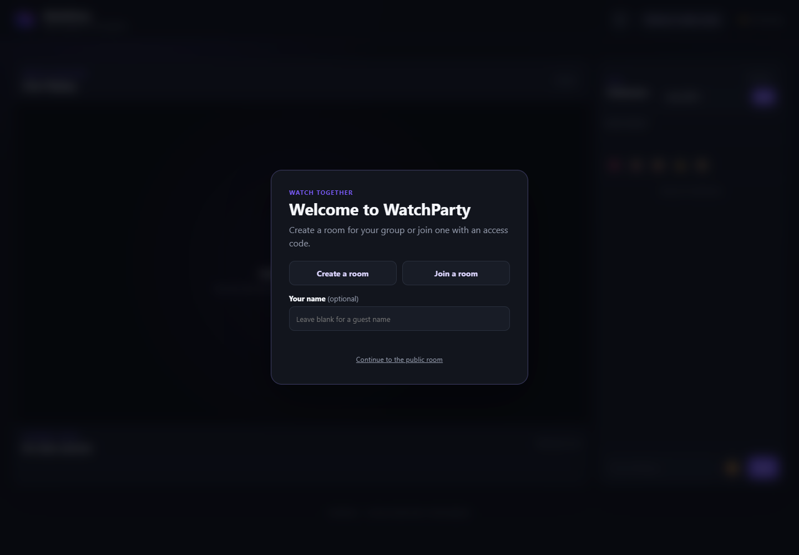
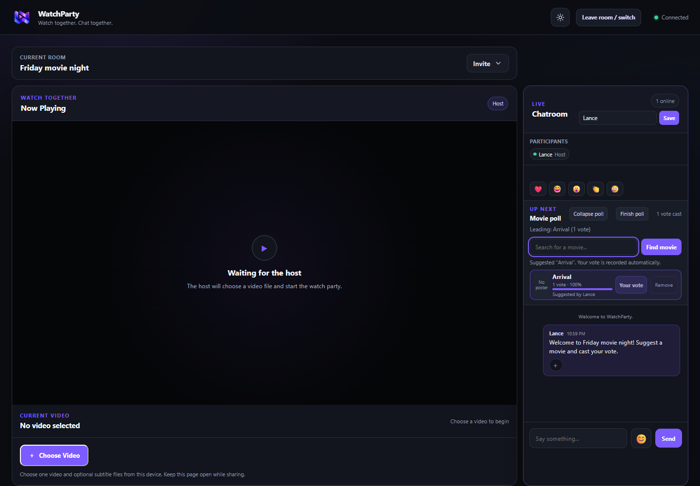
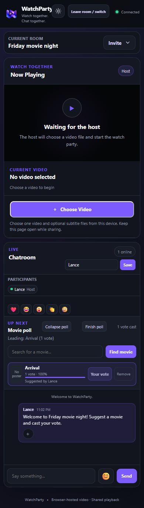

# WatchParty

A browser-hosted watch party with synchronized playback, chat, private rooms, reactions, and next-video voting.

Repository: [andreilance06/watchparty](https://github.com/andreilance06/watchparty)

## Purpose and target users

WatchParty helps friends, classmates, and small groups watch a host's local video together while chatting and deciding what to watch next. The project combines a responsive HTML, CSS, and JavaScript interface with a Node.js server and demonstrates collaborative development through Git branches, commits, and feature integration.

Its objectives are to keep playback synchronized, make group interaction available in one page, and let members contribute separate features to one working application.

## Major features

| Feature | What users can do |
| --- | --- |
| Watch rooms | Create a private room, optionally protect it with a password, and invite others with a link or access code. A public room is also available. |
| Shared playback | Watch a video supplied by the host's browser, with synchronized playback and automatic compatibility streaming when needed. |
| Captions | Add SRT, VTT, ASS, or SSA subtitles and choose a caption track independently. |
| Chat and reactions | Send messages and quoted replies, insert emojis, react to comments, and send floating emoji reactions, including in fullscreen. |
| Movie polls | Start a poll as host, suggest titles with optional Wikipedia metadata, vote, and post the result when the host finishes the poll. |
| Participants and moderation | See connected participants; hosts can manage playback permissions, transfer hosting, and block or unblock viewers. |
| Responsive interface | Use desktop or mobile layouts and switch between light and dark themes. |

## Technologies

| Technology | Role |
| --- | --- |
| HTML, CSS, JavaScript | Page structure, responsive styles, and browser interactions. |
| Node.js and the `ws` package | HTTP server, rooms, and real-time WebSocket messages. |
| Movi Player and WebCodecs | Browser playback and video controls. |
| FFmpeg and HLS | Media inspection and compatibility streaming. |
| JASSUB | Subtitle rendering, including styled ASS/SSA captions. |
| Wikipedia MediaWiki API | Optional movie search, metadata, and poster sources; no API key is required. |
| Git and GitHub | Version history, development branches, and integration of group contributions. |

## Run locally

Prerequisites: Git, Node.js 18 or newer with npm, and a modern browser. The server computer needs these tools; viewers only need a browser. Internet access is needed to install dependencies and use movie search or external posters.

1. Clone the shared repository:

   ```sh
   git clone https://github.com/andreilance06/watchparty.git
   ```

2. Enter the project directory:

   ```sh
   cd watchparty
   ```

3. Install the dependencies. The `ffmpeg-static` package downloads the FFmpeg executable during installation:

   ```sh
   npm install
   ```

4. Start the server and leave the terminal running:

   ```sh
   npm start
   ```

5. Open `http://localhost:3000` in your browser. Stop the server with **Ctrl+C** when finished.

On Windows, if PowerShell blocks `npm.ps1`, use `npm.cmd install` and `npm.cmd start` instead. If FFmpeg's download is unavailable, install a compatible executable and set `FFMPEG_PATH` to its path before starting the server.

For another device on the same network, open one of the LAN addresses printed by the server; `localhost` on that device refers to the device itself. Allow the server through the firewall if necessary. Use [trusted HTTPS](docs/https.md) for LAN and public access to enable WebCodecs on viewers' devices. HTTP still supports native files and compatibility streaming. Keep the Node.js server running; opening `index.html` directly does not provide rooms or shared playback.

## Your first watch party

1. Optionally enter a display name on the welcome screen. Choose **Create a room**, enter a room name, and optionally set an access code and password. Select **Create room**, then **Enter room**. You can also choose **Continue to the public room**.
2. In a private room, use **Invite** to copy the access code. Share the invitation link shown after creation, or have viewers open the same server, choose **Join a room**, and enter the code and password if required. For viewers on another device, use the server's reachable LAN or HTTPS address rather than `localhost`.
3. As host, select **Choose Video** and choose one video, optionally with subtitle files. Keep the browser page that supplies the video open throughout the session. Other participants join the room to watch.
4. Type in the chatroom and select **Send**. Right-click a message (long-press on touch) to reply or choose a reaction. The single emoji button at the bottom opens Message emoji and Global reaction tabs; the latter sends floating reactions to the room.
5. As host, select **Start poll**. Enter a movie title and select **Find movie**; choose a matching result with **Suggest & vote**, or suggest the title without a poster. Suggesting a title automatically casts your vote. Participants can vote for another suggestion, and the host selects **Finish poll** to post the result in chat. A poll chooses what to watch next; the host still selects the actual video file.
6. Select a participant's name to inspect playback permissions. Hosts can change permissions or transfer hosting. Use **Leave room / switch** when you want to leave a private room.

## Screenshots

These screenshots show the running application with local demonstration data. The example room has a chat message and an active movie poll; no video has been selected yet.

### Room selection

Create a new room, join by access code, or continue to the public room.



### Desktop room

The desktop layout places the video panel beside the participant list, movie poll, and chat. The screenshots below predate the message context menu and tabbed emoji picker.



### Mobile room

At a 390-pixel viewport, the video panel and chatroom stack vertically. This full-page capture includes the poll and chat below the player.



## Team and contributions

| Team member | GitHub username | Contributions |
| --- | --- | --- |
| Jobert Aguirre | `jxa-sh-h` | UI design, responsive layout, light/dark themes, voting interface, room-entry interface, invitation display, and movie suggestion search interface. |
| Andrei Lance Asuncion | `andreilance06` | Initial application and modular structure, backend and room management, playback and captions, participant permissions and moderation, and integration of group features. |
| Justin Mandapat | `DarkDream83` | Participant list, shared voting logic, floating emoji reactions, comment reactions, and emoji picker. |

The contribution summary follows the recorded work in the repository. Examples include Jobert's voting interface (`83c0caf`), Justin's participant/reaction/voting implementation (`fcbeee7`) and comment reactions (`b40b5ab`), and Andrei Lance's room/backend work (`3301544`) and integration (`b520781`, `eaff53f`).

## Room behavior

The host selects one video and optional SRT, VTT, ASS, or SSA files. Keep that browser page open: its File objects answer bounded byte requests, with no initial full-file upload. Transferring host keeps that browser as the video provider while the new host controls the room. Refreshing, disconnecting, or blocking the provider ends the current video; the host can choose a replacement from their device.

The root page opens a Create Room / Join Room dialog, with an optional initial display name. Creating a room shows its access code and invitation link; leaving the name blank generates a guest name. In a room, the room name appears above the player panel; use **Invite** to view or copy the private-room access code. Visitors can continue to the public default room, reopen room selection there, or leave/switch from a private room using the header control. See the [room API](docs/rooms.md).

Unexpected host disconnects reserve hosting for 15 seconds so a refresh or brief interruption can reconnect. Other participants see a reconnecting notice; if the host does not return in time, the next connected participant takes over. Explicit room leaving and host transfers take effect immediately. A private room's creator reclaims the sole host role whenever they reconnect, including after leaving and rejoining with the same verified browser identity; any replacement host becomes a viewer. Other hosts cannot block the creator. The public default room has no permanent creator. These identities and rooms last until room expiry or server restart, and localhost and the public domain use separate cookies.

The host starts movie polls from the chatroom. An active poll stays pinned above messages as a compact, expandable card; everyone can suggest and vote. Suggestions search Wikipedia through its keyless MediaWiki API. Choose a matching article for its thumbnail and attribution, or suggest a title without a poster. Suggesting automatically casts your vote. The host and original suggester can remove entries; the suggester keeps that right after browser restarts or rejoining with the same browser cookie and site address while the room/server remains alive. Finishing a poll hides it for everyone and posts the winner, tie, or no-votes result in chat. The host can then start a fresh round. Posters are served by Wikimedia, so availability and licensing depend on each source image. See the [movie poll API](docs/rooms.md#movie-suggestions-and-posters).

## Playback

- **Settings → Quality** offers Auto, Source / Original, and up to 1080p, 720p, 480p, and 360p, plus an independent bitrate limit (Auto, 8, 5, 3, 1.5, or 0.75 Mbps). Smaller sources expose their own size for compatibility playback. Choices are local to each participant, including the host, and remain in the current tab until reload. Source preserves original bytes and disables bitrate overrides; unsupported originals are unavailable.
- Auto is the default. It uses device support, measured media-transfer throughput, buffer health, the video provider's observed upload performance, and current server encoding/CPU pressure. Browser connection information is only an initial hint. Auto budgets 70% of measured viewer throughput, requires repeated evidence before downgrading, waits 30 seconds before upgrading, and spaces switches by at least ten seconds. Adaptation pauses during seeks, pauses, switching, and background inactivity. Default video limits are 5 Mbps at 1080p, 3 Mbps at 720p, 1.5 Mbps at 480p, and 0.75 Mbps at 360p; Auto quality with an explicit limit may use lower default bitrates within that ceiling.
- Manual resolution and bitrate choices remain fixed. A buffering notice offers a return to Auto. Bitrate limits are encoder budgets, not guaranteed download speeds or exact constant bitrates; audio and protocol overhead are additional. Changing quality preserves the shared time, pause state, speed, and captions.
- Alternative renditions are created only after selection, including a current Auto decision. Opening Settings or reading playlists never starts an encoder. The first selected segment request starts encoding; viewers choosing identical dimensions and bitrate share it. Switching prepares the selected fragment before replacing working playback. Unused encoders stop after a ten-second grace period, and inactive rendition files share a 128 MiB per-room cache budget.
- The server permits two concurrent compatibility encoder processes across all rooms by default. Set `WATCHPARTY_MAX_ENCODERS` to a positive integer to change this limit. At capacity, Auto can reuse an eligible active rendition; an unavailable manual selection shows a local busy notice and retains current playback. Necessary HLS bootstrap fragments are also subject to this limit.
- Server transcoding still reads the original from its browser provider. Lower output quality helps viewer downloads, but cannot fix a provider upload too slow to supply that original. A local notice identifies sustained provider starvation; no separate speed-test upload or browser-side transcoding is performed.
- Each device independently chooses original-file playback or compatibility streaming. Supported MP4/WebM sources use native decoding; other suitable sources use Movi's WASM demuxer and WebCodecs. Original-file playback preserves source resolution.
- WebCodecs selection requires a secure context, smooth browser video decoding, and supported audio at the source's actual channel count and sample rate. Silent videos need only `VideoDecoder`. Video and audio checks share a 500 ms deadline; timeouts and standalone WASM video decoding use compatibility streaming.
- Native capability checks include audio as well as video. Unusual audio, unsupported devices, demanding decoding, runtime decoder errors, and sustained stalls use server compatibility streaming. A source with no audio is handled separately from an audio decoding failure.
- Compatibility output uses H.264, 8-bit YUV420, and stereo 48 kHz AAC, capped at 30 fps. It fits within 1920×1080, preserves aspect ratio, and never upscales. HDR sources are tone mapped to SDR.
- The server publishes the full seekable timeline after probing metadata, without waiting for encoder detection or caption extraction.
- Compatibility segments use a fixed frame count near two seconds. Each requested rendition uses a continuous encoder shared by its viewers, retaining AAC state across boundaries and pauses. A private loopback upload sink grants permission before each segment body, bounding production to the shared playhead plus two segments while playing and the target while paused. A paused seek near a segment end may also decode the next fragment; preceding preroll and fragment zero support HLS initialization. Seeks replace stream generations and discard retired files; hls.js loading is suspended during a pause.
- Host seeks are acknowledged with a new playback revision. Old ticks and HLS recovery seeks cannot reset the room clock. Compatibility clients reload the acknowledged generation while preserving pause, speed, and caption selection.
- Direct streams reuse a bounded 16 MiB byte cache and share concurrent reads. HTTP backpressure, cancelled requests, stale source generations, and room membership apply to original bytes as well as generated media.
- Playback-path switches are local to a viewer and preserve the shared timestamp, pause state, speed, and caption choice. They do not replace the room's source or send synthetic play/pause actions.
- Paused and background-tab time does not count toward playback stalls. If compatibility playback fails, the affected browser attempts one local reload per selected video at the current shared position, preserving pause, speed, and captions. Reconnection and replacement loading each have a ten-second limit; failures then show an error without changing the room clock.
- Movi's measured stutter warnings trigger compatibility fallback for hardware and software decoding alike. Browsers may decode supported codecs in software; suitable smooth browser decoding still qualifies for WebCodecs playback.

FFmpeg/HLS remain the compatibility path because browser decoding alone cannot reliably cover every video/audio codec on every phone. The server attempts available hardware encoders, remembers failures for the current source, and falls back to libx264. Conversion uses software decoding so scaling and HDR filters work consistently across encoders.

## Captions and controls

Movi's native **Subtitles/Captions** button, **Settings → Subtitles** page, and context submenu select room captions, including Off. Each viewer chooses independently. Hosts can choose **Add captions** on these surfaces during playback, including when the video has no captions yet; additions preserve existing selections. Cancelling the file picker preserves playback and returns focus to CC. Menus use Movi's own theme, transitions, positioning, and dismissal and show each track's stored name, language, and Default/Forced flags. Tracks without a stored name use “Captions N”; external tracks use their filenames. Subtitle customization/transcript actions are hidden because room captions use the JASSUB renderer.

A valid external subtitle file is attached to the current video regardless of filename. Its timestamps follow the video's clock; unrelated subtitles can show incorrect dialogue or timing. The app does not detect movie matches or automatically align subtitles. Unsupported or unconvertible files report an error and leave the existing captions available.

JASSUB is retained as a libass renderer behind Movi's public renderer/overlay APIs. ASS/SSA styles, positioned signs, karaoke, and embedded font attachments are preserved. Other supported text formats are normalized to ASS. Bitmap subtitles remain unsupported in this version. Selected caption content and fonts begin loading as soon as track descriptors arrive and are cached per browser/source; extraction and renderer initialization never gate the first video frame. A player notice shows “Preparing captions…” followed by “Captions ready” for three seconds, with current status retained in the caption menu. Caption errors leave playback available.

Embedded caption preparation reads container metadata and subtitle payloads selectively, skipping audio/video payloads. It does not upload or copy the entire video for captions, including on localhost. Small framing reads are still necessary; normal media probing and playback have their own read requirements. Subtitle indexes and extracted tracks are shared across viewers of the current source, and replacing the video cancels obsolete work.

Indexed MKVs use `SeekHead` and subtitle `Cues` to jump directly to caption blocks. The index is accepted only when its unique, validated entries match the selected track's `NUMBER_OF_FRAMES` statistic, linked by its full 64-bit TrackUID. Incomplete, inconsistent, or unavailable indexes use complete structural extraction, which can take longer on episode/movie-sized files. Caption ranges travel in bounded batches instead of one relay round trip per tiny header, and caption and playback reads share the relay fairly. Fonts load independently of the complete caption block index. Replacing a video or opening another room starts fresh source-scoped work.

| Container | Embedded text captions |
| --- | --- |
| MKV / Matroska | ASS, SSA, SubRip, and supported WebVTT mappings; styled captions and font attachments are retained. |
| WebM | WebVTT subtitle/caption tracks. |
| MP4 / M4V / MOV / 3GP / 3G2 | MPEG-4 timed text (`mov_text` / `tx3g`), QuickTime text, and WebVTT, including fragmented MP4. Track tables and fragment metadata locate caption samples directly. |
| AVI / OpenDML | Text streams and GAB2-embedded ASS/SRT files, using indexes or RIFF chunk headers. |
| Ogg / OGM / OGV | OGM text subtitle streams; page timing and continued packets are retained. |

Support depends on the actual container layout and subtitle codec, rather than the filename extension. Unsupported or malformed layouts report a caption error and suggest adding an external SRT, VTT, ASS, or SSA file; they never fall back to a full-video caption scan. Other containers, including MPEG transport/program streams and ASF, require external captions. Bitmap subtitles, OCR, Kate, and captions carried inside the video bitstream are not supported. Caption availability does not affect video playback.

Native/HLS engines use the adapter's clock bridge because Movi's embedded renderer hook only runs on its WASM pipeline. The caption canvas lives inside the player, including fullscreen. Native video Picture-in-Picture cannot include this separate subtitle surface; Document PiP support depends on the browser/player.

Click a name in the chatroom's **Participants** list to open its dropdown. Everyone can inspect playback permissions; the host can grant or revoke **Play/pause**, **Seek**, and **Playback speed** for viewers. The same dropdown offers **Transfer host**, **Kick and block**, and **Unblock**. Viewers start with play/pause enabled and seeking/speed disabled; choosing the shared video and managing room captions remain host-only. Volume, aspect ratio, caption selection, and fullscreen are local. Browsers may require a tap to enable sound or playback.

Blocked viewers stay in the participant list with a dimmed, crossed-out name until a host unblocks them. They cannot reconnect to that room, including through another tab in the same browser profile. Blocks survive host changes and disappear with the room or server restart. Unblocked viewers manually rejoin. Transferring host takes effect immediately and preserves the current video, playhead, speed, pause state, and captions; the former host starts with default viewer permissions and continues supplying the video until it is replaced or their browser disconnects. The new host can add captions or choose a new video.

Permissions are checked on the server and remembered for the same browser profile in each room, including after disconnecting or explicitly leaving and rejoining. Other hosts taking over do not reset grants. A viewer becoming host clears that viewer's stored grants; room expiry and server restart clear all grants. Clearing cookies or changing browsers creates a new identity. Private-room passwords and membership are still required after leaving.

## Chat and reactions

Use the single emoji button in chat to open the searchable picker. Its Message emoji tab inserts at the cursor; its Global reaction tab sends a floating reaction to everyone in the room without changing your draft. The picker defaults to Message emoji each time it opens. There is no separate reaction panel. Brief sender/emoji notices also announce global reactions, including with reduced motion enabled.

Messages use rounded incoming/outgoing bubbles with timestamps and compact reaction pills. Right-click a message, long-press it on touch, or focus it and press Shift+F10/Menu to open its action menu. Choose a quick reaction, or click the downward-chevron icon to expand more emoji rows beneath the quick reactions inside the same menu. Click the chevron again to collapse the rows. The expanded section scrolls independently and stays open after selecting reactions. Escape collapses the rows first; press it again to close the menu. Each new message menu starts collapsed. Each person has one reaction per message: choosing another replaces the previous one. Existing reaction-count pills remain clickable: clicking another person's reaction adds yours, and clicking your highlighted reaction removes it. Counts and highlighted ownership follow the server and stay synchronized across tabs and reconnections using the existing browser identity. Different browsers or cleared cookies have separate identities. The bottom emoji picker stays open after selections, preserving its tab, search, and scroll position. Consecutive message emojis insert in order at the cursor. Close the picker with Escape, an outside click, or another click on its opener button; fullscreen changes also dismiss it. Message action menus dismiss on an outside click, chat scrolling, fullscreen changes, or removal of their target message.

Choose Reply from a message's action menu to show its author and text above the composer. Cancel with the preview's close button, or choose another message without losing your draft. Replies appear in the regular chat stream with a quoted preview; selecting the quote scrolls to and highlights the original when it is still available locally. Quotes remain readable if the original is absent. A failed send keeps the draft and reply target; an expired target asks you to cancel the reply or select another message.

Fullscreen shows the same chat and composer in a compact overlay, with a Show/Hide Chat control. Your shown/hidden preference is remembered across fullscreen transitions until you reload the page. The control fades with the video controls and briefly reappears for four seconds with an unread count when new messages arrive. Unread messages clear when the window is focused and the newest messages are visible; opening chat while scrolled upward keeps them unread. Messages, replies, the message action menu, the tabbed emoji picker, and floating reactions work there. Hiding chat still allows incoming floating reactions and brief sender notices. Drafts and scroll position are preserved on entry/exit. Supported fullscreen APIs use the video shell; other browsers use the existing page fullscreen fallback. Native video Picture-in-Picture does not include chat.

New messages from other participants play a quiet notification when chat is hidden or the window is unfocused, including outside fullscreen. Sounds become available after your first interaction with the page and are limited to once per second during bursts. Browser audio restrictions may prevent playback; missed sounds are not replayed later. Your own messages, system notices, and emoji reactions do not trigger notifications.

Chat retains the latest 500 comments per browser; the server retains message text and reaction targets for the latest 500 room comments to validate quoted replies. There is no chat history replay or persistence. Floating reactions are capped at 30 and respect reduced-motion preferences. Next-video suggestions and voting remain shared within the room.

## Performance and verification

The performance targets are a first playable frame within **3 seconds** of selection and an uncached seek within **2 seconds**, with capable hardware, indexed files, and enough network throughput. These are measured targets, not guarantees for arbitrary codecs, slow uploads, long GOPs, unindexed containers, or CPU-only 4K conversion.

In DevTools, inspect `document.getElementById('video').watchpartyMetrics` for `playbackMode` (`native`, `wasm`, or `compatibility`), first-picture, seek, and fallback timings and `fallbackReason`. Here `wasm` identifies Movi's WASM demuxer with WebCodecs video decoding. First-picture timing includes source preparation after registration; the file-picker interaction is excluded. Measure cold page/asset loading separately. Browser autoplay denial must not be classified as codec failure.

`document.getElementById('video').watchpartyQualityMetrics` exposes the local preferences, actual rendition, measured viewer throughput, provider throughput, application-wide encoder demand, pending selection, adaptation reason, and warnings. Measurements come from real uncached relay transfers and media downloads; deliberate encoder/paused-production waits are excluded from viewer transfer timing. Connection estimates are observations, not an Internet speed-test guarantee.

`document.getElementById('video').watchpartyCaptionMetrics` records the selected caption's index mode (`cues`, `structural`, `samples`, or `external`) and extraction/conversion timings. Embedded-source metrics also include caption relay requests, ranges, transferred bytes, and bytes reused from the playback cache; counters are scoped to the current source. Caption responses expose the same snapshot in `X-WatchParty-Caption-Metrics`, with index/conversion durations in `Server-Timing`. Use these to distinguish indexing delays from renderer initialization. The local target for a representative indexed 24-minute episode is caption readiness within five seconds across first and later selections; unindexed files and slow storage/network paths can take longer.

See the [WebCodecs validation results](docs/webcodecs-validation.md) for a three-run comparison of native, WebCodecs, and compatibility playback, resource measurements, and local Caddy HTTPS checks.

```sh
npm test
```

Tests cover room admission/isolation, range validation/cancellation/deduplication, stale generations, fast readiness independent of captions/encoder detection, selective caption reads across supported container families, local fallback negotiation, bounded continuous encoding, AAC timestamps and decoded audio across pause/resume, HEVC Main 10/E-AC-3 conversion, downscaling, encoder failure, seek acknowledgements, caption lifecycle, chat, voting, and proxy trust. Media tests create temporary fixtures and skip if FFmpeg is unavailable. DOM doubles test wiring, not visual decoding.

For release testing, use real desktop Chrome/Edge/Firefox/Safari, Android Chrome, and iPhone/iPad Safari. Check visible motion and audible audio for H.264/AAC MP4, HEVC MKV, VP9/AV1, multichannel/unusual audio, 4K/HDR conversion, and styled ASS. Test cold/warm startup, uncached seeks, fullscreen captions, autoplay gestures, and mixed direct/compatibility viewers in one room.

## Structure and dependencies

`server.js` and `js/app.js` compose the application. Server media modules handle probing, lazy caption extraction, compatibility playlists and continuous encoding runs; `server/source-relay.js` owns browser files and authenticated range serving. Player modules handle source selection, synchronization, Movi controls, and the JASSUB adapter.

Third-party distributions are bundled locally; replace generated distributions as a unit rather than editing them. Movi Player **0.4.1** (slim JS/WASM) is covered by `vendor/MOVI_PLAYER_LICENSE.txt`; JASSUB **2.5.16** and its worker/WASM assets are covered by `vendor/jassub/LICENSE.txt`.

The hls.js pause/resume bridge uses Movi 0.4.1's internal stream-wrapper loader because Movi has no public adaptive-loader pause API. This dependency is isolated in `js/player/compatibility-buffer.js`; verify its integration when upgrading Movi.

`js/player/native-quality-menu.js` isolates the quality Settings hooks, including menu placement when viewer seeking is disabled. `js/player/adaptive-quality.js` observes completed downloads and the pinned hls.js fragment-loading bridge. Verify these integrations and native mobile Settings when upgrading Movi; vendor distributions remain unchanged.

Movi 0.4.1 exposes custom controls and overlays but no host-managed subtitle-menu provider. `js/player/native-caption-menu.js` isolates element-level menu hooks for the room's track list, selection, status, and host-only Add action. It reuses native CC/Settings/context surfaces and leaves decoder methods and the generated bundle intact. Verify these hooks against the real player when upgrading Movi; DOM doubles do not exercise its menu lifecycle or CSS.
