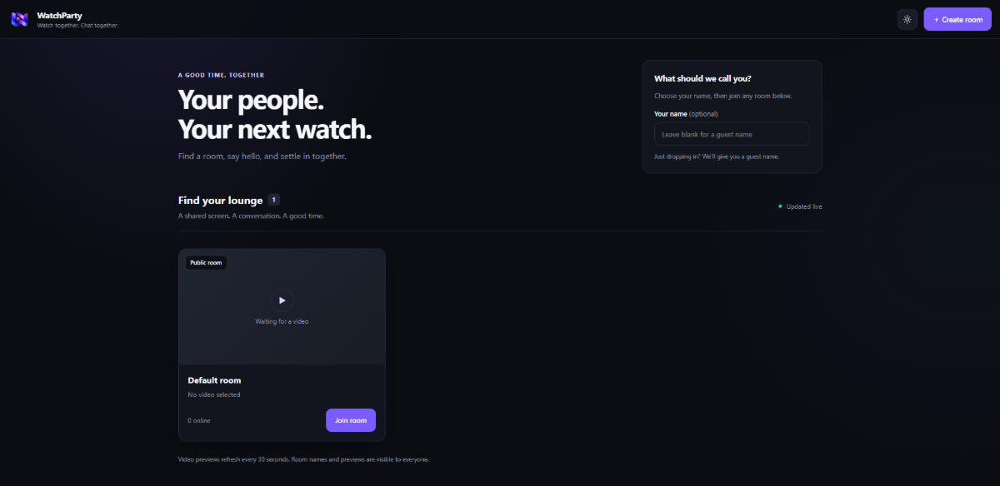
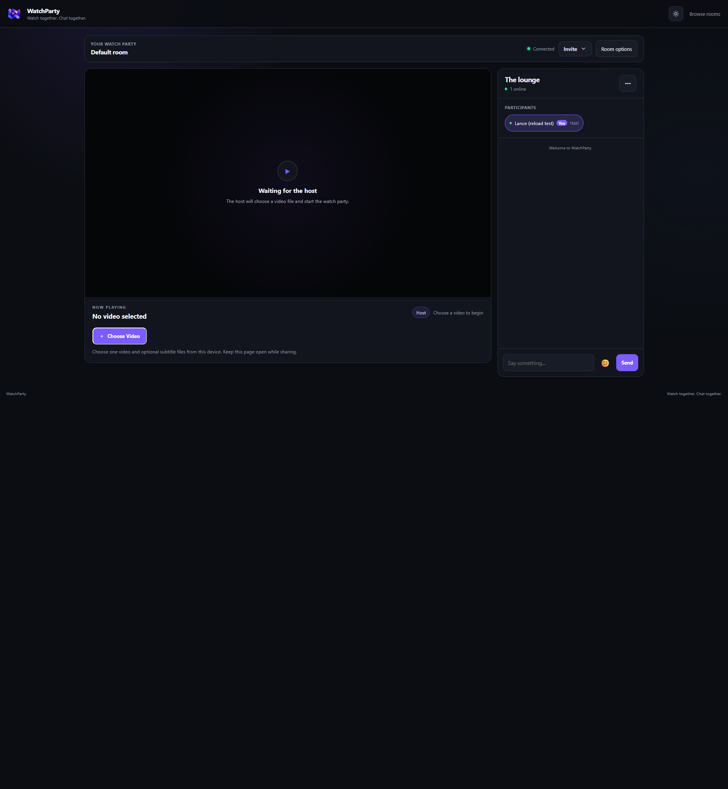
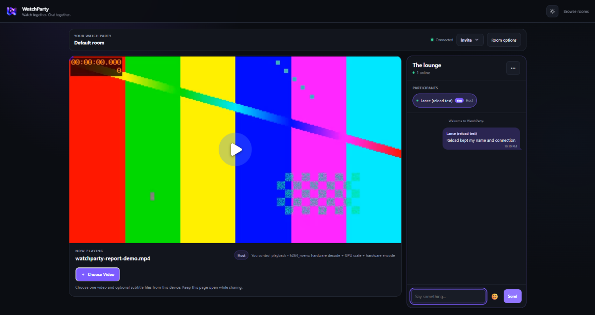

# WatchParty - Deployment and Bug Fixes

**November 11, 2026**

## Deployed using Render

I deployed WatchParty as a Node.js web service on Render and connected my custom domain, **https://ypothesi.space**. Testing the hosted application revealed problems with room admission, reconnecting, chat, and video playback.

## Fixed room admission and user identity

Joining a room initially returned **Request origin is not allowed**. Updating `PUBLIC_ORIGIN` to match the custom domain resolved the admission error.

Reconnecting or reloading could also create a new user and report that my previous name was already in use. The fixes added verified connection replacement and tab-scoped identity restoration. A local browser check confirmed that reloading retained the same client ID and name.

## Fixed chat message alignment

Messages I sent could move from the right side of the chat to the left after reconnecting. Message ownership is now saved when each message arrives, so changing connection IDs does not change the alignment of earlier messages.

## Reduced memory use and fixed quality-switch errors

Render reported memory exhaustion during testing. The application now uses a low-memory profile for small containers, limits FFmpeg processing threads, reduces source buffering, and streams static files instead of loading each requested asset fully into memory.

Switching video quality also exposed failed segment requests. Temporary encoder-capacity failures no longer remain cached as permanent failures, and replacement streams wait for the previous FFmpeg process to release its slot. If another quality cannot start, the player keeps the current video playing and displays a server-busy message.

Cloudflare proxying was disabled during troubleshooting. Retry backoff and clearer HTTP error messages were also added after earlier network responses contained HTML challenge pages instead of the expected API data.

## Verification

The updated backend/browser suite passed **390 tests**. The **19 React tests** and production build also passed. Regression tests covered four viewers sharing one converted stream, reload identity, chat ownership, and quality-switch recovery.

The screenshots show the public deployment and clearly identified local checks. The latest fixes still require verification on Render after deployment; these results do not establish that every production playback issue is resolved.
