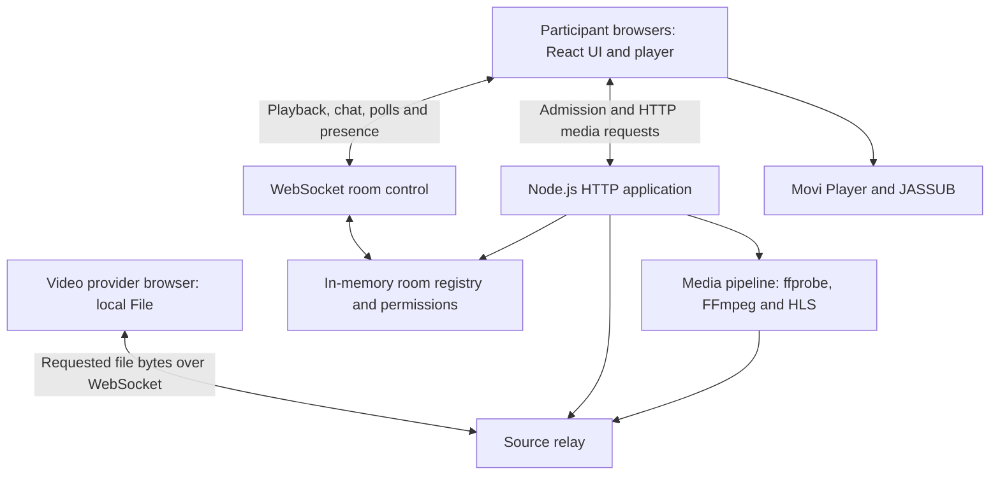
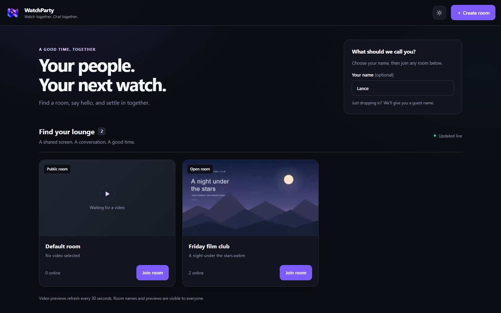
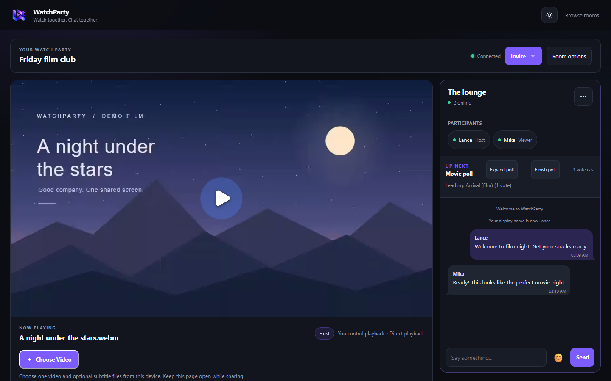
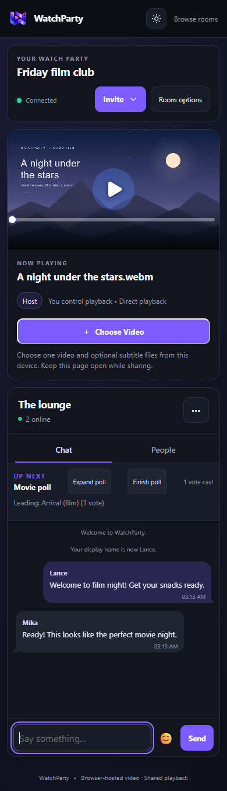
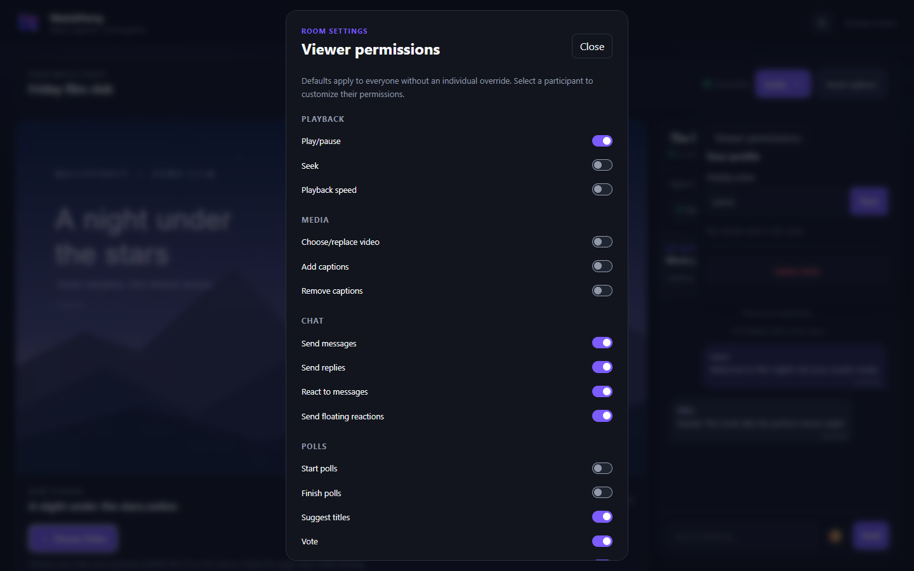

# WatchParty

## Technical Documentation and Project Progress Report

**Project title:** WatchParty: A Browser-Based Synchronized Video Viewing Application  
**Report date:** November 10, 2026  
**Package version:** 1.0.0  
**Project team:** Jobert Aguirre, Andrei Lance Asuncion, and Justin Mandapat  
**Repository:** andreilance06/watchparty  
**Development status:** Core features implemented; local validation completed for selected environments; broader release evaluation remains.

This report describes the current working-tree implementation, including changes that have not yet been committed. The package version is a repository identifier and does not establish a released production version.

---

## 1. Project Overview

WatchParty is a web application that allows people in different locations to watch a video together through a shared room. A participant supplies a local video from their browser, and the application coordinates playback while participants communicate through chat, replies, emoji reactions, and movie polls.

The application combines a React frontend with a Node.js HTTP and WebSocket backend. Its media pipeline supports direct playback, browser decoding through Movi Player and WebCodecs, and FFmpeg-based compatibility streaming. A room hub provides room discovery, invitations, and optional password protection.

The project has progressed beyond a basic prototype: room management, media delivery, social features, participant permissions, responsive layouts, automated tests, and deployment configuration are present. The React migration has also been implemented. Remaining release work includes wider browser and physical-device testing, public deployment verification, and representative network/load evaluation. No completion percentage is assigned because a weighted project schedule and acceptance checklist have not been supplied.

## 2. Problem Statement or Project Purpose

Remote groups often need separate tools for watching videos, discussing content, and choosing what to watch next. Manually coordinating playback causes participants to see different scenes, especially after pauses or seeks. Sharing local files also introduces browser codec limitations and the delay of uploading an entire file before playback.

WatchParty addresses these problems by placing synchronized viewing and group interaction in one interface. It requests portions of the provider's local file as needed and provides compatibility streaming when a browser cannot use the original media. Room permissions allow the host to manage shared controls and participant actions.

## 3. Project Objectives

| Objective | Current progress |
| --- | --- |
| Coordinate playback across participants, including play/pause, seeking, and speed changes. | Implemented with server-maintained playback state and WebSocket updates. |
| Share a local video without requiring an initial full-file upload. | Implemented through browser-owned files and bounded byte-range requests. |
| Support varied media formats and subtitle tracks. | Multiple playback paths and SRT/VTT/ASS/SSA support implemented; device coverage remains to be expanded. |
| Provide communication and shared movie selection. | Chat, replies, message reactions, floating reactions, suggestions, and voting implemented. |
| Give hosts control over room access and participation. | Password-protected admission, invitations, host transfer, permissions, and blocking implemented. |
| Provide a responsive and maintainable interface. | React components, shared state, light/dark themes, and responsive layouts implemented. |
| Establish repeatable validation and deployment procedures. | Automated suites, production build, HTTPS proxy templates, and a VPS deployment guide available. |

Performance targets are a first playable frame within three seconds and an uncached seek within two seconds under suitable hardware, media, and network conditions. These are evaluation targets rather than guarantees for every file or connection.

## 4. Target Users

- **Friends and families:** Watch local videos together while chatting remotely.
- **Classmates and small study groups:** View shared video material and discuss it in one room.
- **Film clubs and small communities:** Suggest titles, vote on the next selection, and host a group session.
- **Hosts and delegated moderators:** Manage participants, playback permissions, captions, and disruptive behavior.

Viewers need a compatible browser and a reachable application server. The participant supplying the video must keep their browser page open and connected throughout playback.

## 5. Features and Functionalities

| Feature | Implemented functionality |
| --- | --- |
| Room directory | Lists available rooms, participant counts, selected filenames, previews, and password requirements. |
| Room creation and admission | Named rooms, optional passwords, display names, invitation links, and a separate player page. |
| Shared playback | Room playback clock, play/pause, seek and speed synchronization, and host-controlled permissions. |
| Media compatibility | Native playback, suitable WebCodecs playback, and FFmpeg/HLS fallback. |
| Quality selection | Per-viewer Auto or manual resolution/bitrate preferences, with options up to 1080p when applicable. |
| Captions | External SRT, VTT, ASS, and SSA files; supported embedded text-caption extraction; independent viewer selection. |
| Chat | Real-time messages, quoted replies, timestamps, emoji insertion, and comment reactions. |
| Floating reactions | Shared animated emoji reactions with reduced-motion handling. |
| Movie polls | Suggestions, optional Wikipedia metadata/posters, votes, and published poll results. |
| Participant controls | Connected-user list, 19 configurable permissions, room defaults, individual overrides, host transfer, blocking and unblocking. |
| Reconnection | A 15-second grace period for unexpected host disconnects and automatic host reassignment when necessary. |
| Responsive presentation | Desktop viewing lounge, mobile Chat/People tabs, light/dark themes, and fullscreen chat. |

Room state is held in memory. There is no persistent account system, media library, or chat-history database. Chat history is bounded, and previous chat is not replayed to newly connected viewers. Room names, filenames, and previews are visible in the directory even for password-protected rooms; admission still protects playback.

## 6. Technology Stack

Versions below are declared dependency ranges or pinned vendor versions from the repository, not claims about the newest available releases.

| Layer | Technology | Purpose |
| --- | --- | --- |
| Frontend | React and React DOM `^19.3.1` | Components, forms, state, context, and rendering. |
| Build tooling | Vite `^8.3.5`, React Vite plugin | Development server, backend proxy, and production bundles. |
| Styling | Tailwind CSS `^4.3.4`, CSS, HTML | Responsive layout, themes, player and chat presentation. |
| Runtime | Node.js `>=24.0.0`, JavaScript | HTTP server, room coordination, and media processing orchestration. |
| Real-time transport | `ws` `^8.18.0` | Playback events, chat, presence, and source-file transport. |
| Player | Movi Player 0.4.1, WebCodecs, WebAssembly | Browser media playback and player controls. |
| Media processing | FFmpeg, ffprobe, HLS | Inspection, transcoding, previews, caption conversion, and compatibility delivery. |
| Subtitle renderer | JASSUB 2.5.16 | Caption rendering, including styled ASS/SSA. |
| External integration | Wikipedia MediaWiki API | Optional title search, metadata, and poster attribution. |
| Testing | Node test runner, Vitest, React Testing Library, jsdom | Backend/media regressions and component interaction checks. |
| Deployment | Ubuntu VPS, Caddy, systemd | Documented HTTPS reverse proxy and persistent application service. |
| Collaboration | Git and GitHub | Source control and feature integration. |

## 7. System Architecture or Application Structure

WatchParty uses a single Node.js application process with separate frontend, room-control, and media responsibilities. Browser clients communicate through HTTP and WebSockets; the server coordinates each room independently.



In public hosting, Caddy terminates HTTPS and forwards HTTP and WebSocket traffic to Node.js on loopback. The architecture requires a single application process because room state is not shared across replicas.

| Location | Responsibility |
| --- | --- |
| `src/main.jsx`, `src/Hub.jsx` | Frontend entry, room directory, and admission forms. |
| `src/room.jsx`, `src/Watch.jsx` | Room context/reducer, connection state, and watch-page composition. |
| `src/Chat.jsx`, `src/Poll.jsx`, `src/Permissions.jsx` | Communication, voting, participant and permission interfaces. |
| `src/Player.jsx`, `js/player/` | React-to-player integration, synchronization, captions, quality, and fullscreen behavior. |
| `js/connection.js`, `js/host-files.js` | Client transport and local-file provider. |
| `server.js`, `server/application.js` | Startup, dependency discovery, HTTP/WebSocket composition, and shutdown. |
| `server/rooms.js`, `server/realtime.js`, `server/permissions.js` | Room lifecycle, event handling, and authorization. |
| `server/source-relay.js`, `server/media/`, `server/http/` | File relay, media processing, byte ranges, and endpoints. |
| `tests/`, `src/frontend.test.jsx` | Backend/media and current React interface tests. |
| `deploy/`, `docs/` | Hosting templates, screenshots, architecture, and validation records. |
| `dist/`, `vendor/` | Generated production frontend and locally bundled third-party distributions. |

## 8. UI/UX Design Screenshots or Wireframes

The following existing repository screenshots show the implemented interface with demonstration content. They illustrate layout and user flows; they are not new screenshots captured for this report or evidence of live public hosting.

### Figure 1. Room selection



The hub groups discovery and admission in one page. Room cards show context before entry, while invitations provide a direct route to a particular room.

### Figure 2. Desktop watch room



The desktop layout places video beside the social lounge. Connection status, invitations, room settings, participants, polls, and chat remain visible around the viewing area.

### Figure 3. Mobile watch room



The narrow layout stacks the video above the lounge and uses tabs to manage limited space. The recorded React migration checks include mobile and tablet emulation; physical-device testing remains necessary.

### Figure 4. Viewer permission controls



Grouped switches allow hosts to configure viewer capabilities. Individual overrides can inherit room defaults, reducing repetitive configuration.

## 9. Implementation Details

### Room admission and state

The room hub uses HTTP APIs to list, create, and join rooms. After admission, `RoomProvider` owns the control WebSocket and updates a reducer with identity, role, participants, permissions, polls, and chat. Browser identities use server-verified cookies rather than registered user accounts. Identities and admission are scoped to the site address, so localhost and a public deployment are separate environments.

The server maintains playback time, paused state, speed, and update timestamps per room. It validates permissions before accepting shared actions and broadcasts accepted changes to participants. Room defaults and individual overrides determine each viewer's effective permissions.

### Browser-owned media delivery

Selecting a file registers the browser as its provider. The server requests bounded ranges instead of waiting for a full upload. Original playback receives authenticated byte-range responses; compatibility playback obtains encoded HLS output. Host control and file ownership are separate: transferring hosting does not transfer the local file, and the original provider must remain connected.

The application discovers usable FFmpeg and ffprobe executables at startup. ffprobe supplies structured media metadata, while FFmpeg performs conversions, thumbnail extraction, and encoding. Shared encoder budgeting limits simultaneous encoders; the default limit is two.

### Playback, captions, and asynchronous work

The player chooses an appropriate playback path based on browser and media support, with compatibility streaming available when required. Adaptive quality uses observed media transfer, buffering, provider throughput, and encoder pressure. Quality and volume are local preferences, while authorized playback controls affect the room.

Session identifiers, media versions, stream generations, and cancellation guard against stale requests after source changes or rapid seeks. Caption extraction is selective where supported, and JASSUB renders captions inside the player. Bitmap subtitles and OCR are outside the implemented caption support.

### Frontend lifecycle and build

React manages the surrounding interface while a stable media adapter owns timing-sensitive player operations. Cleanup releases listeners, timers, requests, relays, and subtitle workers. Fullscreen portals preserve chat drafts and scroll position. Vite builds the frontend into `dist/`, copies vendor assets, and loads the watch page as a separate chunk.

## 10. Testing and Evaluation

### Checks performed for this report — November 10, 2026

| Check | Result |
| --- | --- |
| `npm.cmd run build` | Passed; 48 modules transformed and production assets generated. |
| `npm.cmd run test:ui` | Passed; 12 tests in one test file. |
| `npm.cmd test` | Passed; 380 tests, zero failures, cancellations, or skips. |

The React suite covers admission and validation, retry feedback, storage failures, chat acknowledgments and draft retention, replies/reactions, movie-search fallback, voting, permissions, bounded history, and connection cleanup. Backend/media tests cover room isolation, authorization, source ranges, captions, playback, transcoding, seeking, quality, and related regressions.

### Previously recorded evaluation

[React migration validation](react-frontend.md) records 380 backend/media tests and 12 React tests passing on November 5, 2026. Its two-session desktop Chrome checks verified room admission, chat, video loading, captions, permissions, host transfer, fullscreen draft retention, and responsive emulation.

[WebCodecs validation](webcodecs-validation.md), dated October 21, 2026, reports these three-run medians on a single local Windows/Chrome setup:

| Playback path | First frame | Seek after 30 seconds |
| --- | ---: | ---: |
| Native MP4 | 166 ms | 52 ms |
| WebCodecs MKV | 404 ms | 1,965 ms |
| Compatibility HLS | 1,167 ms | 209 ms |

All three paths met the stated timing targets in that experiment. However, original-file playback had already downloaded the short sample before those seeks, so these figures do not establish uncached seek performance. They also do not establish WAN or mobile performance. The validation document records sample, hardware, measurement, and audio limitations.

[Seek validation](seek-validation.md) additionally records rapid-seek testing, including bursts of 20 seeks, stale-response handling, held-frame behavior, and actual Chrome/FFmpeg integration.

### Evaluation still required

- Test visible playback and audible sound on desktop Firefox/Safari, Android Chrome, and physical iPhone/iPad Safari devices.
- Exercise real network conditions, including limited provider upload, latency, disconnections, and multiple viewers.
- Confirm public HTTPS, cookies, WebSocket upgrades, media ranges, and invitations on the deployed release.
- Conduct representative user evaluation of admission, captions, chat, permissions, and mobile navigation.

Automated DOM tests cannot establish visible decoding quality, audible output, or user satisfaction. No formal usability study or supported audience-capacity result is recorded in the reviewed documentation.

## 11. Deployment Information

### Local operation

Prerequisites are Node.js 24 or newer, npm, a compatible browser, and usable FFmpeg/ffprobe executables. Bundled executable packages provide fallbacks.

```sh
npm ci
npm run dev
```

Development runs the Vite frontend at `http://localhost:5173` and the backend at port 3000. For a production build served locally:

```sh
npm run build
npm start
```

Open `http://localhost:3000`. Windows PowerShell users can use `npm.cmd` if execution policy blocks `npm.ps1`.

### Public hosting configuration

The repository documents an Ubuntu 24.04 VPS deployment for `https://ypothesi.space`, with Caddy for HTTPS and systemd for process management. Templates include `deploy/Caddyfile.public`, `deploy/watchparty.service`, and `deploy/watchparty.env.example`.

The example production environment binds Node.js to `127.0.0.1:3000`, sets `TRUST_PROXY=loopback` and `PUBLIC_ORIGIN=https://ypothesi.space`, and limits encoders to two. The deployment guide includes release creation, checks, logging, updates, and rollback.

**Deployment status:** Configuration and procedures are available. Public DNS, certificates, current service availability, and the deployed application revision were not checked for this report. Local validation does not establish production deployment success.

HTTPS is required for relevant secure-context browser capabilities on remote devices. Run one Node process; restarting it clears in-memory rooms and identities. The video provider's browser must remain connected even when the application server is hosted remotely.

## 12. Challenges Encountered and Solutions

These technical challenges and responses are evidenced by the current implementation and repository validation notes.

| Challenge | Implemented solution | Remaining consideration |
| --- | --- | --- |
| Different browser codec capabilities | Native/WebCodecs playback plus FFmpeg/HLS compatibility paths. | Real-device decoding support and encoding capacity vary. |
| Slow startup caused by full-file transfer | Browser-owned file relay with bounded range reads and caches. | Provider upload and connection stability still limit delivery. |
| Old responses overwriting recent seeks or files | Generation/version checks, request cancellation, accepted-seek acknowledgments, and regression tests. | Continue testing against actual player upgrades. |
| Flicker or lost time labels during seeks | Bounded held-frame overlay and isolated player presentation hooks. | Hooks depend on the pinned Movi integration. |
| Expensive embedded-caption discovery | Selective container reads, lazy extraction, and separate caption metrics. | Unindexed containers and unsupported subtitle types remain limited. |
| Conflicting controls and disruptive participants | Server-side permissions, room defaults, per-user overrides, and moderation. | State is session-based and resets with the room/server. |
| Host interruption or refresh | Reconnect grace period, reassignment, and verified creator restoration. | Losing the active file provider ends the selected video. |
| React integration with an imperative media player | Stable adapter state, cleanup ownership, and lifecycle tests. | Vendor hooks require verification on upgrades. |
| Fullscreen moving chat out of its original layout | Stable portals retain composer state and scroll position. | Native video Picture-in-Picture cannot include the separate chat/caption surfaces. |

The next priorities are cross-browser and physical-device validation, production verification, realistic bandwidth/load measurements, and user feedback. Persistent rooms or chat and multi-process operation would require additional architecture if adopted as future requirements.

## 13. References

1. [Project README](../README.md) — purpose, features, team contributions, setup, and operating limitations.
2. [Package manifest](../package.json) — declared dependencies, runtime requirement, and scripts.
3. [React frontend architecture and migration validation](react-frontend.md) — components, lifecycle, build, and recorded checks.
4. [Room API and behavior](rooms.md) — room admission, shared actions, and protocol behavior.
5. [WebCodecs validation](webcodecs-validation.md) — local playback measurements and HTTPS checks.
6. [Seek presentation and ffprobe validation](seek-validation.md) — seek regressions and media inspection.
7. [Deployment guide](deployment.md) — VPS provisioning, release installation, verification, and rollback.
8. [HTTPS guide](https.md) — secure-context and reverse-proxy setup.
9. [Screenshot directory](screenshots/) — existing UI captures used in this report.
10. [Movi Player license](../vendor/MOVI_PLAYER_LICENSE.txt) and [JASSUB license](../vendor/jassub/LICENSE.txt) — bundled third-party acknowledgments.

All implementation and evaluation claims in this report are based on the local project files and the checks identified above. The report does not rely on a live external-service audit.
