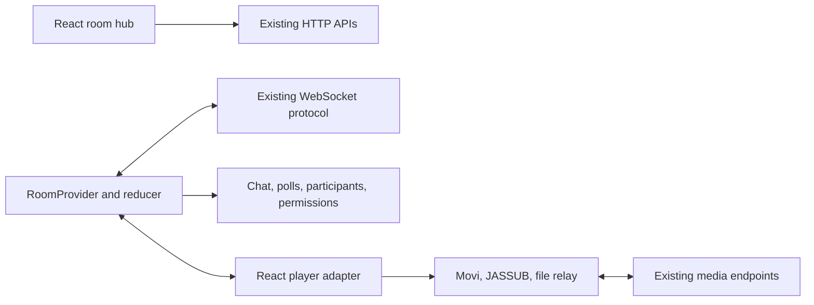

# React frontend

WatchParty uses React, Vite, and Tailwind CSS with its existing Node.js/WebSocket
backend. The migration preserves `/`, `/watch?roomId=ID`, and `/?room=ID` links,
the room protocol, browser-owned video sharing, and the Movi/JASSUB distributions.

## Components and state

- `Hub` renders room cards, polls the directory while visible, and handles validated
  create/join forms, invitations, protected-room sessions, and retry feedback.
- `RoomProvider` owns admission and the control WebSocket. Its reducer holds the
  identity, role, permissions, participants, poll, bounded chat history, and status.
- `Watch` composes the room bar, player, stable portal hosts, and persistent Chat,
  People, and Up next panels. `RoomControls` owns the on-demand display-name and
  room-name editors, invitations, room-permission entry, and provider-aware leave flow.
- `Chat`, `Poll`, and `Participants` render application data through React. Forms
  keep local drafts; successful server acknowledgments commit shared changes.
- `PermissionFields` is reused for room defaults and participant overrides.
- `ThemeProvider`, `Header`, `Dialog`, and `Status` supply shared UI.



The player adapter holds a stable mutable media session separately from React's
render state. Timing-sensitive decoding, synchronization, quality selection, and
captions stay in the existing media modules. Ref-owned status elements and player
internals are updated by that adapter; the surrounding application uses React
state and event handlers. Cleanup releases intervals, listeners, source relays,
pending requests, subtitle workers, menus, and the player.

Fullscreen moves external portal containers, not React-owned children. The chat
portal stays mounted, retaining input drafts and scroll position. Emoji and
message popovers use a portal that also moves into the fullscreen shell.

## Styling and build

Tailwind is compiled by `@tailwindcss/vite`. Theme tokens reference the original
CSS variables, preserving dark/light modes. Existing visual rules live in a lower
cascade layer; `css/components.css` defines shared controls and `css/watch.css`
owns the player-page composition and responsive breakpoints. The former layout,
lounge, and responsive override files have been consolidated into the watch page.
`css/hub.css` owns the hub composition in the same component layer. The shared
SVG icon set and native dialogs serve both pages.
The existing baseline is retained instead of adding Tailwind Preflight over the
player. Specialized player, caption, animation, and detailed presentation CSS is
preserved.

Vite proxies API, room, HLS, and WebSocket requests during development. It preserves
the incoming Host and Origin headers so origin validation and same-origin cookies
continue to work. Production serves only built frontend assets from `dist`, with
HTML revalidated and hashed bundles cached immutably. Unknown API and asset paths
return 404. Vendor JavaScript, WASM, workers, fonts, and licenses are copied without
modification, preserving relative paths.

## Development and validation

Use Node.js 24 and npm:

```sh
npm ci
npm run dev
```

Open `http://localhost:5173`. For production verification:

```sh
npm run build
npm test
npm run test:ui
npm start
```

Open `http://localhost:3000`. Backend/media tests require the build for HTTP asset
checks. React tests cover admission, validation, retry feedback, storage failures,
chat acknowledgments and draft retention, replies/reactions, movie-search fallback,
voting, permission fields, bounded history, and StrictMode connection cleanup.
The legacy DOM fixtures are test-only media regression scaffolding; current UI
tests use React Testing Library and Vitest.

Before release, use two independent browser sessions and verify native and
compatibility playback, seeks, captions, manual/automatic quality, host transfer,
reconnects, fullscreen chat, keyboard navigation, themes, and mobile/tablet layouts.
Desktop Chrome checks do not establish decoding behavior in Safari or on phones.

### Migration validation

Validated locally on 2026-11-05:

| Check | Result |
| --- | --- |
| Production build | Passed without build warnings; watch page is loaded as a separate chunk. |
| Node backend/media regression suite | 380 passed, no failures or skips. |
| Vitest/React Testing Library | 12 passed, including StrictMode admission cleanup and chat acknowledgment followed by a batched presence update. |
| Media adapter remount | Repeaters, document/window/player listeners, and overridden player hooks return to their original state after two mounts. |
| Production Chrome, two isolated sessions | Room creation and invitation admission, chat delivery, shared playback, caption addition/readiness, viewer permissions, and host transfer verified. |
| Playback engines | Auto compatibility streaming and manual Source/native playback both loaded the generated H.264/AAC test video. |
| Fullscreen chat | One chat input remained mounted; its draft survived entry and exit, returning to the lounge afterward. |
| Responsive layout | Desktop, 390×844 mobile emulation, and 768×1024 tablet emulation checked without horizontal page overflow. |
| Vite development | Hub requests, admission, cookies, and control WebSocket worked through port 5173. |

This is local validation, not a production deployment or a Safari/physical-device
test. Existing deployment and cross-browser release checks still apply.

## References

- [React effects and external systems](https://react.dev/reference/react/useEffect)
- [Vite documentation](https://vite.dev/guide/)
- [Tailwind Vite integration](https://tailwindcss.com/docs/installation/using-vite)
- Existing vendor acknowledgments and contribution history remain in the README.
